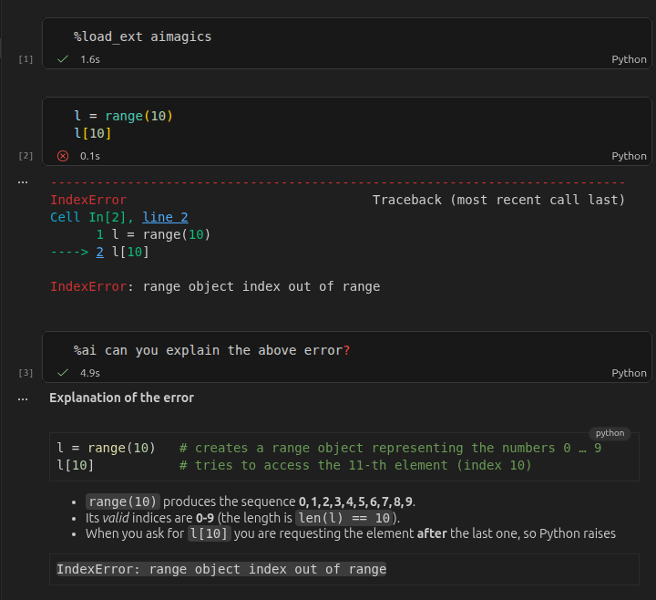

# aimagics


<!-- WARNING: THIS FILE WAS AUTOGENERATED! DO NOT EDIT! -->

<a id="screenshot"></a>


## Installation

This package can be installed with pip via

``` sh
$ pip install aimagics
```

## Setup

### 1. Load the package

After installation, you can load the package in Jupyter and ipython with

``` python
%load_ext aimagics
```

or with

``` python
import aimagics
```

Whether the package has been loaded can be checked with

``` python
from IPython import get_ipython
get_ipython().extension_manager.loaded
```

    {'IPython.extensions.storemagic', 'aimagics'}

‘aimagics’ should appear in the output.

### 2. Set OpenRouter API key and choose model

The default model is

``` python
AIMagics().model
```

    'openrouter/deepseek/deepseek-flash-latest'

and the environment key needed is `OPENROUTER_API_KEY`.

### 3. Turn auto save on

The package works by retrieving the current notebook from disk. To always get the current state, it is recommended to turn auto save on. This is the default in jupyter notebooks, and can be toggled in vscode via `Show and Run Commands` \> `File: Toggle Auto Save`.

## Usage

The package exposes two commands: `%ai` and `%%ai`. These are so-called ‘line’ and ‘cell magics’ and can be used as follows:

### Line magic

The command `%ai` processes what comes after on the same line as request to the LLM:

``` python
%ai What is aimagics, briefly?
```

`aimagics` is a package that enables easy access to Large Language Models (LLMs) directly from within Jupyter notebooks using magic commands (`%ai` and `%%ai`). It allows users to interact with LLMs for coding assistance, learning, and exploration, leveraging the context of the current notebook session. This setup provides targeted responses, facilitates learning, and aims to enrich the interactive experience within Jupyter environments.

### Cell magic

The command `%%ai` processes what comes after it on the same line, but also what is in the same cell below it:

<!-- Sorry this is hard-coded because of some issues with getting the output of %%ai in nbdev. 
The code ran as expected, see hidden cell below-->

``` python
%%ai Why does the following code fail?
1/0
```

**Answer**

``` python
1/0
```

fails because it raises a **`ZeroDivisionError`**. In Python (and mathematics), division by zero is undefined, so attempting to compute `1 / 0` triggers this exception:

    ZeroDivisionError: division by zero

To avoid the error, ensure the denominator is never zero, e.g.:

``` python
denominator = 2  # any non‑zero value
result = 1 / denominator
```

By default, the entire notebook up to and including the calling cell is included in the prompt as context.

## Configuration

The possible configuration options can be viewed with

``` python
%config AIMagics
```

    AIMagics(Magics) options
    ----------------------
    AIMagics.model=<Unicode>
        Provider/model to be used.
        Current: 'openrouter/deepseek/deepseek-flash-latest'
    AIMagics.system_prompt=<Unicode>
        The system prompt prepended to any prompt and context.
        Current: 'You are a helpful assistant living inside a user\'s Jupyter notebook.\n    The user is generally interested in how things work, why, and to try them out immediately.\n    Use markdown syntax for styling your responses.\n    Keep your responses brief and to the point, they should fit in a few cells at most.\n    Your response will be post-processed: Fenced code will be split out and appended at the end as code cells.\n\nFollow the **fast.ai coding style**.\nIts core philosophy stems from Kenneth Iverson\'s maxim: *"Brevity facilitates reasoning."* By minimizing unnecessary vertical space, developers can see entire functions or algorithms in a single screen view without scrolling.\n\nThe key tenets include:\n\n---\n\n### Layout and Vertical Economy\n\n* **One Line, One Idea:** Fit complete simple statements onto a single line rather than breaking them across multiple lines.\n* Single-statement conditions: `if not data: return None`\n* Single-line functions: `def foo(x): return x * 2`\n* Single-line imports: `import os, sys, pathlib`\n\n* **No Artificial Line Breaks:** Don\'t split argument lists, list literals, or dictionary definitions across vertical lines unless they genuinely exceed horizontal space.\n* **Destructuring Assignment:** Group `self` attribute initializers together:\n```python\nself.x, self.y, self.z = x, y, z\n```\n\n* **Wide Screens Over 79/88 Chars:** Fast.ai allows line lengths around **160 characters** to accommodate modern monitors rather than adhering to rigid, narrow limits.\n* **Visual Alignment:** Group related 1-liners without blank lines between them, and align similar statement structures so the eye spots pattern differences immediately.\n\n---\n\n### Naming and Abbreviations\n\nFast.ai uses a combination of **Huffman Coding** and the **Life-Cycle Naming Principle**:\n\n| Scope / Lifecycle | Rule | Examples |\n| --- | --- | --- |\n| **Short-lived** (lambdas, list comprehensions, tight loops) | Aggressive 1-2 letter abbreviations | `x` (input), `y` (target), `o` (generic object), `i` (index), `f` (function) |\n| **Medium-lived** (local variables, function arguments) | Standard domain abbreviations | `lr` (learning rate), `bs` (batch size), `sz` (size), `tfms` (transforms) |\n| **Long-lived** (public classes, exported modules) | Full words, light or no abbreviations | `Learner`, `DataLoaders`, `Transform` |\n\n---\n\n### Systematic Affixes\n\nFast.ai relies on uniform affixes across the entire library:\n\n* **Plurals / Collections (`s`):** `xs`, `ys`, `tfms`\n* **Counts (`n_` or `num_`):** `n_epochs`, `n_layers`, `num_features`\n* **Boolean checks (`is_`):** `is_tuple`, `is_valid`\n* **Conversions (`2` / `to_`):** `to_device()`, `name2idx()`\n\n---\n\n### Idioms & Performance\n\n* **Vectorization Over Loops:** Rely on PyTorch/NumPy broadcasting and tensor indexing rather than Python loops.\n* **Domain-Specific Spacing:** Match mathematical notation. Omit spaces around operators where tight grouping reflects arithmetic priority or domain convention (e.g., `path/filename` without padding `/`).\n* **No Generic Auto-Formatters:** Traditional tools like Black or Flake8 violate fast.ai\'s density principles and are intentionally avoided in fastai projects.\n'

For example, you can change the model with

``` python
%config AIMagics.model = "google/gemini-3.8-flash"
```

### Documentation

Documentation can be found hosted on this GitHub [repository](https://github.com/adrische/aimagics)’s [pages](https://adrische.github.io/aimagics/).
<!-- Additionally you can find package manager specific guidelines on [conda][conda] and [pypi][pypi] respectively. -->
Additionally you can find package manager specific guidelines on [pypi](https://pypi.org/project/aimagics/) respectively.

## Use cases

### Interactive coding

You can just ask away with `%ai your question`, the LLM will get the relevant context and can provide targeted answers. Good for iterative programming, studying, etc. See the [screenshot above](#screenshot).

### Interactive document reading

Code along with technical documents. By importing and splitting documents into Jupyter cells, you can read step-by-step and ask and try out code as you go.

A possible workflow is to get documents (e.g., websites) to markdown format with Jina,

https://r.jina.ai/www.the-website-you-want.com

then add markdown cells with

``` python
from aimagics.utils import add_cells, split_markdown
md = """[copy paste from Jina]"""
add_cells(split_markdown(md))
```

If you want to start from a notebook that has been prepopulated with cells from a markdown file, there are options such as [Jupytext](https://jupytext.org/) to convert a markdown file to ipynb that you can use as a starting point.

For example, you can translate an existing markdown file to ipynb such that each section gets its own cell by

``` bash
jupytext --to ipynb --opt split_at_heading=true file.md
```

## Features

### Automatic code-cell insertion

LLM answers containing fenced code blocks (with \`\`\`) are automatically extracted and inserted as code cells below the LLM reply:

``` python
%ai how to reverse a list in one line?
```

**Answer**

\[See code cell 1 below\]

``` python
# Code cell 1
rev = lst[::-1]          # slice reversal
# or
rev = list(reversed(lst))  # using built‑in reversed()
```

### AGENTS.md

If it exists in the same folder as the current notebook, the file `AGENTS.md` is being appended to the LLM call.

## Acknowledgements

This repository would not be possible without the FastAI / AnswerAI open source packages, in particular [FastLLM](https://github.com/AnswerDotAI/fastllm). AnswerAI even have a dedicated platform for notebooks with AI integration: [SolveIt](https://solve.it.com/).

There are a number of packages implementing basically the same ideas (just much better):

- [AnswerDotAI/ai-jup](https://github.com/AnswerDotAI/ai-jup) An extension for Jupyter Lab
- [AnswerDotAI/ipyai](https://github.com/AnswerDotAI/ipyai) An extension of IPython in the terminal
- <https://nathancooper.io/blog/2026-08-10-ipython-is-all-you-need> An excellent blog post implementing these ideas much better for ipython.

During the finishing stages I also found <https://pypi.org/project/aimagic/> on PyPi, which is also a package by AnswerAI and basically what I am implementing here, even with the same syntax and the same name, just for Jupyter (relying on Javascript to get the cells for context).
